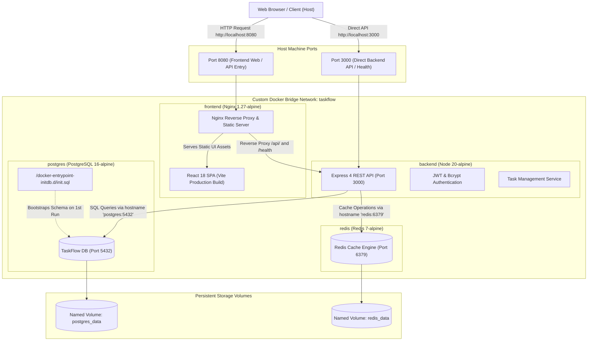

# Mid-Semester Examination – Software Engineering and DevOps
## Set 2 – Evening Shift

**Practical Examination: Docker, Docker Compose, Docker Hub and CI/CD**

---

## 1. Examination Details

| Particular | Details |
|---|---|
| Subject | Software Engineering and DevOps |
| Examination | Mid-Semester Examination – 2 |
| Set | Set 2 – Evening Shift |
| Repository | [MSE-2-SSED-Evening](https://github.com/atindeRR/MSE-2-SSED-Evening) |
| Submission Mode | GitHub Pull Request + PDF on Moodle |

---

## 2. Problem Statement

You are required to containerize and deploy the provided full-stack application using Docker and Docker Compose.

Your task is to create optimized Docker images for the frontend and backend, configure container networking, implement health checks, manage persistent database storage, publish Docker images to Docker Hub, and implement an automated CI/CD pipeline using GitHub Actions.

The final application must run successfully using the published Docker images without requiring the frontend or backend source code to be built on the deployment machine.

**Important:** You must implement the solution independently. Merely copying configurations without understanding their functionality may affect your practical evaluation and viva.

---

## 3. Repository Setup

1. Open the examination repository:

   https://github.com/atindeRR/MSE-2-SSED-Evening

2. Fork the repository into your personal GitHub account.

3. Clone your forked repository:

   ```bash
   git clone https://github.com/YOUR_GITHUB_USERNAME/MSE-2-SSED-Evening.git
   cd MSE-2-SSED-Evening
   ```

4. Configure Git with your details if required.

5. Perform all implementation and testing in your forked repository.

---

## 4. Implementation Requirements

### Task 1: Optimized Dockerfiles

Create Dockerfiles for both frontend and backend.

**Frontend Dockerfile requirements:**

- Implement a multi-stage Docker build.
- Use a Node.js image for the build stage.
- Use Nginx or another suitable lightweight web server for the production runtime.
- Copy only the required production build artifacts into the final image.
- Expose the appropriate application port.
- Ensure the frontend application runs successfully.

**Backend Dockerfile requirements:**

- Use an appropriate Node.js base image.
- Install only the required dependencies.
- Avoid copying unnecessary files into the image.
- Use a production-oriented configuration.
- Expose the backend application port.
- Ensure the backend starts successfully.

**Deliverable:** Two working and optimized Dockerfiles.

### Task 2: Docker Compose – Networking and Health Checks

Create a `docker-compose.yml` file to run the complete application.

Your Compose configuration must include:

- Frontend service.
- Backend service.
- PostgreSQL service.
- Redis service.
- A custom Docker network.
- A named volume for PostgreSQL data.
- Appropriate health checks for PostgreSQL, Redis and backend.
- Proper service dependencies using health conditions wherever applicable.
- Environment variables for service configuration.

Additional requirements:

1. The backend must communicate with PostgreSQL and Redis using their Docker Compose service names.
2. The frontend must communicate with the backend successfully.
3. PostgreSQL and Redis should not unnecessarily expose their ports to the host machine.
4. Containers must communicate through the custom Docker network.
5. Database data must persist even when the PostgreSQL container is removed and recreated.

### Task 3: Docker Hub Image Publishing

Build and publish your frontend and backend Docker images to your personal Docker Hub account.

Use the following naming convention:

**Frontend:**

```text
YOUR_DOCKERHUB_USERNAME/frontend:v1
YOUR_DOCKERHUB_USERNAME/frontend:latest
```

**Backend:**

```text
YOUR_DOCKERHUB_USERNAME/backend:v1
YOUR_DOCKERHUB_USERNAME/backend:latest
```

Requirements:

- Create the required repositories on Docker Hub.
- Build the Docker images.
- Tag each image with both `v1` and `latest`.
- Push all four image tags to Docker Hub.
- Verify that the images are available in your Docker Hub account.

### Task 4: Image-Based Deployment

Create a separate file named:

```text
docker-compose.deploy.yml
```

This file must deploy the application using the images published on Docker Hub.

Requirements:

- Use the published frontend and backend Docker Hub images.
- Use the `latest` tag for deployment.
- Do not use `build:` for frontend and backend services.
- Use official PostgreSQL and Redis images.
- Configure the custom network.
- Configure PostgreSQL persistent storage using a named volume.
- Include appropriate health checks and service dependencies.
- Ensure all application services start and communicate successfully.

Run the deployment using:

```bash
docker compose -f docker-compose.deploy.yml up -d
```

Verify that the application is accessible and working.

### Task 5: Networking and Persistence Verification

Demonstrate and verify the following:

1. Frontend can communicate with the backend.
2. Backend can resolve and connect to PostgreSQL using the service name.
3. Backend can resolve and connect to Redis using the service name.
4. PostgreSQL data remains available after the PostgreSQL container is removed and recreated.
5. Redis service can be restarted successfully.
6. Health checks correctly report the status of the relevant services.

You must capture screenshots or terminal outputs demonstrating these tests.

### Task 6: GitHub Actions CI/CD Pipeline

Create a GitHub Actions workflow:

```text
.github/workflows/cd.yml
```

The workflow must execute automatically whenever code is pushed to the `main` branch.

Your pipeline must perform the following stages:

1. Checkout the source code.
2. Set up the Docker build environment.
3. Build the frontend Docker image.
4. Build the backend Docker image.
5. Authenticate with Docker Hub using GitHub Secrets.
6. Tag both images with `v1` and `latest`.
7. Push all image tags to Docker Hub.
8. Deploy the application using `docker-compose.deploy.yml`.
9. Verify that the application and required services are running successfully.

**Required GitHub Secrets:**

Configure the following secrets in your forked repository under:

`Settings → Secrets and variables → Actions → New repository secret`

| Secret Name | Description |
|---|---|
| `DOCKERHUB_USERNAME` | Your Docker Hub username |
| `DOCKERHUB_TOKEN` | Your Docker Hub access token |
| `POSTGRES_PASSWORD` | Password for PostgreSQL |

Do not hardcode credentials or access tokens in your source code or workflow files.

**Important:** Your pipeline must complete successfully. Capture screenshots of the completed workflow stages.

---

## 5. GitHub Pull Request Submission

After completing the implementation:

1. Commit and push all your changes to your forked repository.
2. Create a Pull Request from your fork to the original examination repository.
3. Target the `main` branch of the original repository.
4. Ensure your Pull Request contains all required implementation files.
5. Verify that the instructor's CI pipeline executes on your Pull Request.

Use the following Pull Request title format:

```text
DOCKER-SET-2 | ROLL-NUMBER | STUDENT-NAME | SECTION
```

**Example:**

```text
DOCKER-SET-2 | 123456 | Rahul Sharma | AIML-A
```

Do not submit an empty Pull Request. All implementation files must be committed before submission.

---

## 6. Mandatory PDF Documentation

Every student must prepare a PDF document containing the implementation details and evidence of successful execution.

**PDF filename format:**

```text
ROLL_NUMBER_STUDENT_NAME_SET2.pdf
```

Your PDF must contain the following information:

### A. Student Information

- Student Name
- Roll Number
- Section
- Branch
- GitHub Username
- Docker Hub Username

### B. Repository and Submission Details

- GitHub Fork Repository URL
- GitHub Pull Request URL
- Branch Name
- Docker Hub Frontend Image URL
- Docker Hub Backend Image URL
- GitHub Actions Workflow Run URL

### C. Implementation Evidence

Include screenshots demonstrating:

1. Frontend Docker image build.
2. Backend Docker image build.
3. Docker Compose services running.
4. Custom Docker network configuration.
5. PostgreSQL and Redis health checks.
6. PostgreSQL data persistence verification.
7. Docker Hub repositories containing `v1` and `latest` tags.
8. Successful image-based deployment using `docker-compose.deploy.yml`.
9. Frontend and backend application working successfully.
10. GitHub Actions CI/CD pipeline with all required stages passed.
11. Successful instructor CI checks on your Pull Request, wherever available.

### D. Declaration

Include the following declaration at the end of your PDF:

> I hereby declare that the submitted implementation has been completed by me. I have tested the Docker configurations, Docker Compose deployment, Docker Hub image publishing and GitHub Actions CI/CD pipeline. The screenshots and evidence included in this document represent my actual implementation.

**Submission Instructions:**

- Upload the completed PDF to Moodle.
- Attach the same PDF to your GitHub Pull Request.
- Ensure all URLs are accessible and point to your actual submissions.

---

## 7. Important Instructions

1. Every student must work on their own forked repository.
2. Use your personal GitHub and Docker Hub accounts.
3. Do not share GitHub or Docker Hub access tokens.
4. Do not hardcode passwords or credentials in the repository.
5. Ensure that all Docker images are pushed successfully to Docker Hub.
6. Ensure the deployment works using Docker Hub images rather than local builds.
7. All required GitHub Actions stages must pass.
8. The Pull Request must be created against the original examination repository.
9. PDF documentation is mandatory.
10. Screenshots must be genuine and should represent your actual implementation.
11. Be prepared to explain your Dockerfiles, Docker networking, volumes, health checks and CI/CD workflow during the viva.

**Incomplete implementations, missing screenshots, incorrect Docker Hub image links or missing PDF documentation may affect your practical evaluation.**

---

## 8. Final Submission Checklist

Before submitting, verify the following:

- [ ] Repository forked successfully.
- [ ] Frontend Dockerfile implemented using multi-stage build.
- [ ] Backend Dockerfile implemented.
- [ ] `docker-compose.yml` configured.
- [ ] Custom Docker network created.
- [ ] PostgreSQL named volume configured.
- [ ] Required health checks implemented.
- [ ] Frontend and backend images built successfully.
- [ ] Both `v1` and `latest` tags pushed to Docker Hub.
- [ ] `docker-compose.deploy.yml` uses published images.
- [ ] Image-based deployment tested successfully.
- [ ] Networking and persistence verified.
- [ ] GitHub Actions CD workflow executed successfully.
- [ ] Pull Request created against the original repository.
- [ ] Instructor CI checks passed, wherever available.
- [ ] PDF documentation prepared with all required screenshots.
- [ ] PDF uploaded to Moodle.
- [ ] PDF attached to the GitHub Pull Request.

**Good Luck!**


---

# Practical Examination Implementation & DevOps Documentation

**Author:** Akshat Shandilya  
**GitHub Profile:** [Akshat88658](https://github.com/Akshat88658)  
**Repository:** [MSE-2-SSED-Evening](https://github.com/Akshat88658/MSE-2-SSED-Evening)  
**Subject:** Software Engineering and DevOps – Mid-Semester Examination 2 (Set 2 – Evening)

---

## 1. System Architecture & Component Overview

The TaskFlow application is an enterprise-pattern multi-tier application composed of four interconnected containerized services running on an isolated custom Docker bridge network.



### Component Details & Network Isolation

| Service | Container Base Image | Internal Port | Host Port | Role & Isolation Policy |
|---|---|---|---|---|
| **frontend** | `nginx:1.27-alpine` | `80` | `8080` | Serves compiled React static assets; reverse-proxies `/api/` and `/health` to backend service. |
| **backend** | `node:20-alpine` | `3000` | `3000` | Express REST API handling business logic, JWT authentication, and caching. Exposed for automated API tests. |
| **postgres** | `postgres:16-alpine` | `5432` | *None (Isolated)* | Primary relational database storing users and tasks. Strictly accessible only within `taskflow` network. |
| **redis** | `redis:7-alpine` | `6379` | *None (Isolated)* | In-memory key-value cache with AOF persistence. Accessible only within `taskflow` network. |

---

## 2. Dockerfile Design & Multi-Stage Optimization

### Frontend Multi-Stage Build (`frontend/Dockerfile`)
The frontend is constructed using a multi-stage build to decouple the compilation environment from the production runtime:

1. **Stage 1: Build Stage (`node:20-alpine`)**:
   - Copies `package.json` and runs `npm install` to download build dependencies (Vite, React, React-DOM, Babel plugins).
   - Copies application source code and executes `npm run build`.
   - Produces highly optimized, minified HTML, JavaScript, and CSS bundles in `/app/dist`.
2. **Stage 2: Production Stage (`nginx:1.27-alpine`)**:
   - Discards all Node.js runtimes, package managers, and development source files, resulting in an ultra-lean (~25MB) final production image.
   - Copies only the production `/app/dist` assets into `/usr/share/nginx/html`.
   - Installs a custom `nginx.conf` that handles Client-Side Routing (`try_files $uri $uri/ /index.html;`) and acts as a reverse proxy for API traffic.
   - Embeds a container-level `HEALTHCHECK` probing `http://127.0.0.1/`.

### Backend Multi-Stage Build (`backend/Dockerfile`)
The backend image enforces production hardening and least-privilege principles:

1. **Stage 1: Dependencies Stage (`node:20-alpine`)**:
   - Isolates dependency resolution.
   - Executes `npm install --omit=dev && npm cache clean --force` to install only production dependencies (`bcryptjs`, `cors`, `express`, `jsonwebtoken`, `pg`, `redis`).
2. **Stage 2: Production Stage (`node:20-alpine`)**:
   - Sets `ENV NODE_ENV=production`.
   - Copies `/app/node_modules` from the dependencies stage.
   - Copies only application runtime code (`src/` and `package.json`), excluding tests, logs, and git metadata via `.dockerignore`.
   - Switches execution to the built-in unprivileged user `USER node` to prevent root container escalation.
   - Launches application directly with `CMD ["node", "src/server.js"]` for immediate POSIX signal handling.

---

## 3. Docker Compose Orchestration & Health Checks

### Custom Network (`taskflow`)
All four containers communicate over a custom user-defined bridge network `taskflow`. This provides:
- Automatic Docker DNS service discovery (containers resolve each other by service names `postgres`, `redis`, `backend`, `frontend`).
- Network-level isolation from other host containers.
- Security isolation for database and cache layers (ports `5432` and `6379` are not bound to the host interface).

### Health Checks & Dependency Synchronization
To eliminate race conditions during startup, services use active health checks combined with `condition: service_healthy`:

1. **PostgreSQL Health Check:**
   - Probes database readiness using `pg_isready -U taskflow_user -d taskflow`.
   - Periodically queries PostgreSQL to confirm the database engine is accepting connections.
2. **Redis Health Check:**
   - Probes Redis status using `redis-cli ping`.
   - Verifies the in-memory server responds with `PONG`.
3. **Backend Health Check:**
   - Runs `node -e "fetch('http://127.0.0.1:3000/health').then(r=>process.exit(r.ok?0:1)).catch(()=>process.exit(1))"`.
   - Queries the backend `/health` endpoint, which internally validates active connectivity to both PostgreSQL and Redis.
4. **Service Dependency Chain:**
   - `postgres` & `redis` start first and perform self-health checks.
   - `backend` starts only after `postgres` AND `redis` report `service_healthy`.
   - `frontend` starts only after `backend` reports `service_healthy`.

---

## 4. Persistent Storage & Disaster Recovery

- **Volume Configuration:** Named volume `postgres_data` is mounted to `/var/lib/postgresql/data`.
- **Database Initialization:** `./backend/db/init.sql` is mounted to `/docker-entrypoint-initdb.d/init.sql:ro`. Upon initial volume creation, PostgreSQL automatically runs this script to initialize the `users` and `tasks` tables and indexes.
- **Persistence Guarantee:** When the PostgreSQL container is stopped or removed (`docker compose rm -f postgres`), the underlying `postgres_data` volume remains intact. When a new container is instantiated, all existing records, users, and tasks are instantly recovered.

---

## 5. Docker Hub Publishing & Image-Based Deployment

### Image Tagging Convention
Images are tagged with both semantic version `v1` and mutable release tag `latest`:

- **Frontend:**
  - `YOUR_DOCKERHUB_USERNAME/frontend:v1`
  - `YOUR_DOCKERHUB_USERNAME/frontend:latest`
- **Backend:**
  - `YOUR_DOCKERHUB_USERNAME/backend:v1`
  - `YOUR_DOCKERHUB_USERNAME/backend:latest`

### Pure Image-Based Deployment (`docker-compose.deploy.yml`)
The production deployment manifest contains **no `build:` directives**. It deploys the entire stack using published images pulled directly from Docker Hub:
```bash
docker compose -f docker-compose.deploy.yml up -d
```
This guarantees portability across environments without requiring Node.js, Vite, or local build toolchains on target deployment servers.

---

## 6. GitHub Actions CI/CD Pipeline (`.github/workflows/cd.yml`)

The automated pipeline triggers on every push to the `main` branch:

1. **Checkout Repository:** Retrieves source files and Docker configuration.
2. **Secret Validation:** Verifies existence of `DOCKERHUB_USERNAME`, `DOCKERHUB_TOKEN`, and `POSTGRES_PASSWORD`.
3. **Docker Buildx Setup:** Initializes modern build engine with layer caching support.
4. **Docker Hub Authentication:** Authenticates against Docker Hub registry using encrypted secrets.
5. **Build & Push Stages:** Builds and pushes backend and frontend images tagged with both `v1` and `latest`.
6. **Environment Generation:** Securely generates `.env` injecting `POSTGRES_PASSWORD` from repository secrets.
7. **Compose Validation:** Verifies `docker-compose.deploy.yml` has no `build:` keys and satisfies Compose syntax.
8. **Deployment & Verification:** Pulls published images, executes deployment, waits for container health checks, and verifies frontend HTTP response.
9. **Automated Smoke Testing:** Executes the comprehensive Jest test suite (`tests/api.test.js`) against the deployed stack.
10. **Clean Teardown:** Safely terminates ephemeral containers after test verification.

---

## 7. PowerShell Verification & Testing Guide

Run the following commands in Windows PowerShell inside the repository root:

### 1. Build and Run Local Stack
```powershell
# Copy environment template if .env does not exist
Copy-Item .env.example .env

# Validate Docker Compose file configuration
docker compose config

# Build local images and start all services
docker compose up -d --build

# Inspect running containers and health status
docker compose ps
```

### 2. Verify Health Checks & Network Isolation
```powershell
# Verify PostgreSQL health check
docker inspect --format='{{json .State.Health.Status}}' taskflow-postgres

# Verify Redis health check
docker inspect --format='{{json .State.Health.Status}}' taskflow-redis

# Verify Backend health check
docker inspect --format='{{json .State.Health.Status}}' taskflow-backend

# Check backend health endpoint directly
curl http://localhost:3000/health

# Check frontend accessibility
curl http://localhost:8080/
```

### 3. Verify PostgreSQL Data Persistence
```powershell
# 1. Register a test user via API
$regBody = '{"name":"Persistence Tester","email":"persist@test.com","password":"password123"}'
Invoke-RestMethod -Uri http://localhost:3000/api/auth/register -Method Post -Body $regBody -ContentType "application/json"

# 2. Stop and remove the PostgreSQL container
docker compose stop postgres
docker compose rm -f postgres

# 3. Start PostgreSQL container again using the same volume
docker compose up -d postgres

# 4. Wait for PostgreSQL to become healthy
Start-Sleep -Seconds 10

# 5. Attempt login with the previously registered user to prove data persisted
$loginBody = '{"email":"persist@test.com","password":"password123"}'
Invoke-RestMethod -Uri http://localhost:3000/api/auth/login -Method Post -Body $loginBody -ContentType "application/json"
```

### 4. Verify Redis Cache & Restart Resilience
```powershell
# Restart the Redis container
docker compose restart redis

# Verify Redis is healthy again
docker inspect --format='{{json .State.Health.Status}}' taskflow-redis

# Query backend health endpoint to confirm Redis connection re-established
curl http://localhost:3000/health
```

### 5. Verify Image-Based Deployment
```powershell
# Stop local build stack
docker compose down

# Set your Docker Hub username environment variable
$env:DOCKERHUB_USERNAME = "YOUR_DOCKERHUB_USERNAME"

# Start application using published Docker Hub images
docker compose -f docker-compose.deploy.yml up -d

# Verify all services are healthy and running
docker compose -f docker-compose.deploy.yml ps
```

---

## 8. Practical Examination Screenshot Checklist (For PDF Submission)

Capture and label the following screenshots for your examination PDF submission:

| # | Screenshot Item | Command / Screen | Key Detail to Highlight |
|---|---|---|---|
| **1** | Frontend Docker Build | `docker build -t frontend:test ./frontend` or `docker compose build frontend` | Multi-stage build (build stage + production stage) |
| **2** | Backend Docker Build | `docker build -t backend:test ./backend` or `docker compose build backend` | Production dependencies stage and non-root user setup |
| **3** | Docker Compose Stack Status | `docker compose ps` | All 4 services running with `(healthy)` status |
| **4** | Custom Docker Network | `docker network inspect <project>_taskflow` | Subnet, gateway, and all 4 containers attached to bridge network |
| **5** | Service Health Checks | `docker inspect --format='{{json .State.Health}}' <container>` | Successful exit code 0 for pg_isready, redis-cli ping, /health |
| **6** | PostgreSQL Persistence Test | Terminal showing user creation -> `docker compose rm -f postgres` -> recreate -> successful login | Data retained across container deletion |
| **7** | Docker Hub Repositories | Web browser on `hub.docker.com` | Repositories for frontend and backend showing `v1` and `latest` tags |
| **8** | Image-Based Deployment | `docker compose -f docker-compose.deploy.yml up -d` & `docker compose ps` | Containers running without local source build |
| **9** | Web Application in Browser | Browser open at `http://localhost:8080/` | TaskFlow UI loaded, tasks added, cached source indicated |
| **10** | GitHub Actions Workflow Run | GitHub repository Actions tab (`Publish and Verify` run) | Green checkmarks across all workflow stages |
| **11** | Automated Test Results | Terminal showing `npm test` or GitHub Actions step summary | All 12 integration test cases passing |

---

## 9. Viva Voce Preparation Guide (Questions & Answers)

### Q1: Why did you use a multi-stage Docker build for the frontend?
> **Answer:** In a single-stage build, Node.js, npm, devDependencies, and the entire source code remain in the final image, bloating it to over 400MB. A multi-stage build uses Node.js only in a temporary build stage to compile the React code into static assets (`dist/`), and then copies only those static files into an unbloated Nginx Alpine runtime image (~25MB), maximizing performance and eliminating build tools from production.

### Q2: Why is Nginx used as a reverse proxy instead of having the browser call `http://backend:3000`?
> **Answer:** Client-side JavaScript runs inside the user's web browser on the host machine. The browser cannot resolve Docker internal network hostnames like `backend`. By configuring Nginx to listen on port 80 and proxy `/api/` to `http://backend:3000/api/`, the browser only needs to make relative requests (`/api/tasks`). This eliminates Cross-Origin Resource Sharing (CORS) complications and avoids exposing the backend service directly to external networks.

### Q3: Why are PostgreSQL and Redis ports not exposed to the host machine in `docker-compose.yml`?
> **Answer:** Security best practices follow the principle of least privilege. Only the frontend web server (and optionally the backend API for debugging/testing) needs to be reachable from outside the host. PostgreSQL and Redis only need to accept connections from the backend container. Placing them on an isolated Docker bridge network allows internal communication while shielding them from unauthorized external network access.

### Q4: How does `condition: service_healthy` prevent application startup failures?
> **Answer:** By default, Docker Compose `depends_on` only waits for a container to *start*, not for the application inside to be ready. PostgreSQL and Redis require several seconds to initialize sockets and read storage. Without health checks, the backend would start immediately, fail to connect to the database, and crash. `condition: service_healthy` ensures the backend process is not launched until `pg_isready` and `redis-cli ping` return success.

### Q5: What happens to the database data if the PostgreSQL container is destroyed?
> **Answer:** Container filesystems are ephemeral, but Docker volumes are independent entities managed outside container lifecycles. Because we mapped a named volume (`postgres_data:/var/lib/postgresql/data`), database files reside safely on the host's Docker volume storage directory. Recreating or upgrading the PostgreSQL container simply re-mounts the existing volume with zero data loss.
